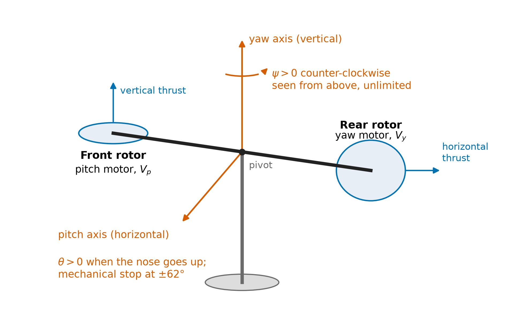

# Multivariable control of a 2-DOF helicopter (Quanser AERO)

**Identification, LQR and decoupled PD control on real hardware**

Mini-project, Polytech Nancy (Université de Lorraine), 5th year, autumn 2026.
A **two-student project** by **Rayan Kobrossly** and **Pierre Baudin**.

📄 **Final report (French):** [`report/Rapport_AERO_V2.pdf`](report/Rapport_AERO_V2.pdf)

📝 **Two-page paper (English):** [*Can we trust a model to fly a helicopter?*](report/Paper_AERO.pdf)

---

## Contents

1. [The system](#1-the-system)
2. [The question behind the project](#2-the-question-behind-the-project)
3. [Methodology](#3-methodology)
4. [Main takeaways](#4-main-takeaways)
5. [Repository layout](#5-repository-layout)
6. [How to run the code](#6-how-to-run-the-code)
7. [What is not in this repository](#7-what-is-not-in-this-repository)
8. [Limits and future work](#8-limits-and-future-work)
9. [Credits and references](#9-credits-and-references)

---

## 1. The system

<p align="center">
  
</p>

The **Quanser AERO** is a laboratory helicopter with two propellers mounted on a beam that pivots on a mast:

- **2 inputs**: the voltages of the front motor ($V_p$) and the rear motor ($V_y$);
- **2 outputs**: the **pitch** angle $\theta$ (nose up / down, limited by mechanical stops) and the **yaw** angle $\psi$ (rotation around the mast, unlimited);
- **sampling**: MATLAB/Simulink with Quanser **QUARC** hardware-in-the-loop, $T_s$ = 2 ms;
- **sensors**: incremental encoders on both axes (the angular velocities are obtained by filtered differentiation).

What makes it a good control exercise:

- **Strong coupling (MIMO).** Each motor acts on both axes: the front rotor lifts the nose *and* turns the body through its reaction torque; the rear rotor turns the body *and* tilts the nose. Controlling the two angles independently requires a multivariable approach.
- **Nonlinearities.** Thrust grows roughly with the square of the voltage, dry friction creates a dead zone on yaw at low voltage, and a centrifugal effect appears when the yaw spins fast.
- **Real hardware, one unit.** Every controller was tested on the physical setup, not only in simulation.

## 2. The question behind the project

The course guide suggests computing an **LQR** (linear quadratic regulator) from a linear model of the AERO. A controller computed on a model is only as good as that model. The project therefore treats the **model** as much as the **controller**:

> obtain a model, check in which domain it is valid, then check on the hardware what the controller inherits from it.

Four verifiable objectives guided the work:

| | Objective |
| :-- | :-- |
| **O1** | Evaluate Quanser's grey-box model on the real setup by comparing simulation and measurement for the same controller. |
| **O2** | Re-identify the model parameters with the **CONTSID** toolbox while keeping the physical structure, and validate the model on tests not used for identification. |
| **O3** | Design an LQR and compare simulation and hardware (static error, coupling, saturation). |
| **O4** | Go beyond the LQR with a **decoupled PD** controller, compared with the LQR on the same criteria and the same reference signal. |

No specification was imposed: the evaluation criteria and their thresholds were written by the team during the project, and the report says so.

## 3. Methodology

The work follows the classic control design loop (*objectives → model → controller → test → analyse the gaps → back to the model*), taken from Dorf & Bishop and suggested by the course guide. The loop was run **twice**.

```
          ┌──────────────────────────────────────────────────────────────┐
          │                                                              │
          ▼                                                              │
   ┌─────────────┐    ┌──────────────┐    ┌──────────────┐    ┌──────────┴───────┐
   │   Model     │ ─▶ │  Controller  │ ─▶ │ Hardware test│ ─▶ │ Simulation vs    │
   │             │    │  design      │    │ (QUARC, 2 ms)│    │ measurement gaps │
   └─────────────┘    └──────────────┘    └──────────────┘    └──────────────────┘
   Loop 1: Quanser grey-box model  ──▶  LQR (4 tunings, steps then ramps)
   Loop 2: re-identified model + dry friction  ──▶  decoupled PD
```

### 3.1 Loop 1: Quanser model and LQR

1. **Open-loop characterisation.** Voltage steps on one motor at a time (three amplitudes per motor) separate the direct effect of a motor from its cross effect on the other axis, and give a first test of linearity (for a linear system, the response divided by the voltage does not depend on the voltage). A combined test with both motors checks superposition.
2. **Grey-box model.** Quanser's knowledge model: pitch is a mass-spring-damper, yaw is an inertia with viscous damping, and the two motors are mixed by a static matrix of torque gains. It gives a 4-state linear state-space model $(\theta, \psi, \dot\theta, \dot\psi)$.
3. **LQR design.** A state feedback $u = K\,(x_{ref} - x)$ on both motors, with $K$ computed from the model and a pair of weights $(Q, R)$. Four tunings were compared in simulation and then on the hardware: Quanser's default weighting, a "softer" one (higher $R$), a "more damped" one (velocity weights) and a **Bryson's rule** tuning.
4. **Step vs ramp references.** With large step references, the LQR asked for far more voltage than the ±20 V the motors accept: the motors saturated and the coupling between axes was large. Rate-limiting the reference to a ramp (slope chosen in simulation) kept the error small, removed saturation and cut the coupling by about an order of magnitude.
5. **Gap analysis.** Simulation and hardware disagreed mainly on the **pitch static error**. Tracing it back showed that the model overestimated the motor gains, which pointed loop 2 towards re-identifying the parameters.

### 3.2 Loop 2: identified model, friction and decoupled PD

1. **Parameter identification with CONTSID (SRIVC).** The structure of Quanser's model was kept (imposed by the teacher), and its parameters were re-estimated with the **SRIVC** method of the CONTSID toolbox, which estimates *continuous-time* transfer functions directly from sampled data, so the estimated coefficients map onto physical parameters (stiffness, damping, torque gains).
   - Test signals: ±8 V square waves on one motor at a time (above the yaw dead zone, slow enough to neglect the centrifugal effect), plus a 10 V step for the pitch-to-yaw transfer.
   - Model orders: second order (with a free pure delay) for pitch, first order plus integrator for yaw.
   - Since a transfer function only gives ratios, the inertias were kept from Quanser and the other parameters derived from them.
2. **Three-level validation**, from the most to the least favourable for the model:
   1. fit on the identification test;
   2. open-loop fit on tests *not used* for identification (both motors moving);
   3. **closed-loop prediction**: the LQR gain is simulated on both models and compared with the real LQR tests. The key criterion is the **pitch static error**, because in closed loop the feedback hides model errors and fit values stay high even for a wrong model.
3. **Dry friction model.** Linear parameters changed from one test to another (damping, yaw time constant), which a linear model cannot explain. A **Coulomb friction + Karnopp stick** model was added to the simulation model and fitted by nonlinear least squares on the full simulated test (CONTSID does not handle this nonlinear model), then validated on separate tests.
4. **Homogeneity (linearity) test**, requested by the teacher. Five-second voltage pulses of increasing amplitude on the yaw motor: if the system were linear, the yaw speed per volt would be the same at every level. The propeller speed was logged too, to separate the motor from the thrust.
5. **Decoupled PD design.**
   - In the model structure, coupling is purely **static** (only the motors mix the axes), so multiplying the requested torques by the inverse of the torque-gain matrix, $W = B_t^{-1}$, decouples the axes in the model.
   - The **relative gain array (RGA)** was used to justify the decoupler over two independent PD loops.
   - Each axis then gets a PD tuned by **pole placement** on the identified parameters, with the derivative on the measurement to avoid voltage kicks.
   - A **spring feedforward** on pitch supplies the torque needed to hold an angle.
   - A tuning factor on one cross gain of the decoupler was tested on the hardware.

### 3.3 Evaluation criteria

All tests, simulated or real, are scored by the same scripts on the recorded signals only:

| Criterion | What it measures |
| :-- | :-- |
| Static error | gap between reference and the angle at the end of each plateau (median over moves) |
| Coupling | largest deviation of one axis while only the other axis moves |
| Saturation | share of time spent at the ±20 V limit |
| Control activity | total voltage variation per second (control noise) |
| Overshoot | maximum beyond the target, in % of the move |
| Fit | NRMSE-based agreement between measured and simulated signals |

The **median** limits the weight of a move disturbed by the other axis. The fit says whether the *shape* of a response is reproduced, not whether the static gain is right; this distinction turned out to be central (see below).

## 4. Main takeaways

- **The model, not the controller, explained most of the gaps.** Each large simulation-vs-hardware gap was traced to a model defect with a measured cause: motor gains overestimated in Quanser's model, a strongly voltage-dependent yaw gain (thrust ∝ V², dry friction), and a motor torque efficiency below one.
- **The identified model predicts the closed-loop behaviour of the LQR** much better than Quanser's model, on tests that were not used for identification.
- **Fit values can be misleading in closed loop.** Two models with very different static gains can produce similar fits, so a physically meaningful criterion (the static error) was needed to discriminate them.
- **Ramp references matter as much as the gains.** With ramps, the LQR no longer saturates and the coupling drops sharply.
- **The PD vs LQR comparison is not fully fair**, and the report says so: the spring feedforward exists on the PD only. It explains most of the PD's lower static error, and the static decoupler did not reduce the measured coupling.
- **A linear model is only valid in a narrow voltage range** (around the identification level). The homogeneity test showed that the yaw response per volt is far from constant, while the motor itself is close to linear: the nonlinearity comes from thrust and friction.

The full results, numbers and figures are in the [report](report/Rapport_AERO_V2.pdf) (sections 4 to 6).

## 5. Repository layout

```
.
├── README.md
├── report/
│   ├── Rapport_AERO_V2.pdf           final report (French, 31 pages)
│   ├── Paper_AERO.pdf                short paper (English, 2 pages)
│   └── scripts/                      scripts cited in annex E of the report (figures and recomputed values)
├── LQR/                              loop 1: LQR design, tuning and evaluation
├── reponse_BO_experimentation/       open-loop tests, CONTSID identification, friction model
├── Modele_estimation/                loop 2: decoupled PD design and analysis, yaw linearity
│   ├── 2 DOF Control/                Quanser's original control files (LQR / PID models and design scripts)
│   └── 2 DOF Parameter Estimation/   Quanser's original parameter-estimation files
├── reponse_BF_experimentation/       closed-loop LQR recordings (data not pushed)
├── simulink/                         Simulink / QUARC models used on the hardware
├── CONTSID7_6/                       CONTSID 7.6 toolbox (redistributed with the teacher's permission)
└── docs/
    ├── img/                          images used by this README
    └── notes/                        working notes and intermediate analyses (mostly French)
```

### `LQR/`: loop 1

| File | Role |
| :-- | :-- |
| `quanser_aero_parameters.m`, `quanser_aero_state_space.m`, `quanser_aero_lqr.m` | Quanser's parameters, state-space model and LQR gain (called by the Simulink models) |
| `tune_lqr_AERO.m` | computes the 4 LQR tunings, simulates them, scores them and saves the results |
| `tune_lqr_model_refined.m` | same evaluation on the re-identified model |
| `compare_lqr_ramp_AERO.m` | step vs ramp comparison, simulation vs hardware, for the 4 tunings |
| `computeMetrics.m` | **common scoring function** (static error, coupling, saturation, overshoot…) used by every comparison |
| `modelError.m` | simulation-vs-measurement error indicators |
| `plot_lqr_AERO*.m`, `lqr_presentation_AERO.m` | plots of the LQR tests (including the oral presentation figures) |
| `signal_generator_comparison.slx` | reference generator used to compare step and ramp references |
| `quanser_aero_parameters_identified_2.mat` | a set of identified parameters |

### `reponse_BO_experimentation/`: open loop and identification

| File | Role |
| :-- | :-- |
| `step_response_AERO.m`, `step_response_AERO_impr.m`, `step_input_comparasion.m`, `plot_all_tests_AERO.m`, `aero_display.m` | viewing and comparing the open-loop recordings |
| `identify_steps_AERO.m` | first identification from one open-loop step |
| `identify_quanser_AERO.m` | **CONTSID / SRIVC identification** of the four transfer functions and mapping to physical parameters |
| `fit_friction_AERO.m` | fit of the Coulomb + Karnopp dry-friction model by nonlinear least squares |
| `quanser_aero_parameters_identified*.mat` | identified parameter sets (the main one and its variants) |
| `aero_friction_parameters.mat` | identified friction parameters |
| `Step_resp_Qube.mdl` | Simulink model used to record step responses |

### `Modele_estimation/`: loop 2

| File | Role |
| :-- | :-- |
| `decoupled_pd_AERO.m` | design of the decoupled PD: decoupler, RGA, pole placement, simulation |
| `decoupled_pd_volt_torque.m`, `setup_decoupled_pd_simulink.m` | gains in torque units and setup of the Simulink PD model |
| `q_aero_2dof_pid_control_new.slx` | Quanser's PID model modified into the decoupled PD (torque PDs, feedforward, decoupler, saturation) |
| `plot_decoupled_pd_tests_AERO.m`, `figures_pd_presentation_AERO.m` | analysis of the PD hardware tests and comparison with the LQR |
| `plot_yaw_linearity_AERO.m` | yaw homogeneity (linearity) test |

### `simulink/`

QUARC / Simulink models run on the hardware during the project: basic read/write and step tests (`Aero_RW.slx`, `Aero_basic_tests.slx`, `Aero_step_responses_pitch_from_yaw.slx`), the LQR models (`q_aero_2dof_lqr_control*.slx` for the hardware, `s_aero_2dof_lqr_control.slx` for simulation), the plant model `quanser_aero.slx` and the reference generator `signal_generator_comparison.slx` (with `save_script.m`).

### `report/scripts/`

Copies of the scripts listed in annex E of the report. They redraw the report figures and recompute every value quoted in the text (`fig_08_identification.m`, `fig_09_erreur_statique.m`, `fig_12_friction.m`, `fig_14_15_pd.m`, `pd_ess_mediane.m`, `params_tableau_25.m`, …). They were written for the original working tree, one level above this repository, so their paths need adjusting (see below).

### `docs/notes/`

Working notes written during the project, mostly in French: the decoupled PD guide and report, the model-linearity guide, the identification summary, friction notes, LQR ramp reports, and review notes for the presentation. They document the reasoning behind the choices but are not polished. Some reference figures by file name that live next to the scripts that produce them.

## 6. How to run the code

**Requirements**

- MATLAB **R2025a** or newer (needed by CONTSID 7.6), with the Control System Toolbox and the Optimization Toolbox (for the friction fit);
- Simulink; **Quanser QUARC** only for running models on the hardware;
- the **CONTSID 7.6** toolbox, included in `CONTSID7_6/`.

**Paths.** The analysis scripts locate their dependencies relative to the repository root (for example `addpath('../LQR')` and `addpath('../CONTSID7_6')`). Run them from their own folder, or add the folders once:

```matlab
cd <path-to-repo>
addpath(genpath('CONTSID7_6'), 'LQR', 'Modele_estimation', 'reponse_BO_experimentation', 'simulink')
```

Some files were moved into `simulink/` and `report/scripts/` when the repository was cleaned up. A few scripts may need an extra `addpath` or a path fix before they run as they did during the project.

**Data.** The raw test recordings (`.mat`, well over 100 MB) are **not** in the repository; only the identified parameter sets are. Scripts that load recordings need the corresponding files placed in their folder.

## 7. What is not in this repository

To keep the repository small and clean, the following stay local:

- raw test recordings (`.mat`) and Excel exports (`.xlsx`);
- Simulink / QUARC build artifacts and caches (`slprj/`, `*.slxc`, `*.rt-win64`, `*_quarc_win64/`);
- Quanser's PDF manuals (Lab Guide, Grey-box Modelling, data sheet), which are copyrighted; they are available from Quanser;
- intermediate figures, older duplicates and unused material from before the project.

## 8. Limits and future work

The report is explicit about its limits:

- **Single runs.** Each LQR tuning and each PD test was run once, so small differences between tunings are not significant.
- **Unfair PD/LQR comparison.** The spring feedforward is on the PD only, and on pitch only; the LQR's equivalent pre-compensation was only simulated.
- **No integral action.** No tested controller has integral action, so a residual static error remains.
- **Narrow validity domain.** The linear model is valid only in a narrow voltage range, and the closed-loop tests go beyond it.

Natural next steps:

1. integral action (LQI, or a decoupled PID with anti-windup);
2. a fair comparison, with feedforward on both controllers and both axes;
3. multi-input identification with a common denominator per axis (SRIVC supports MISO models);
4. identification at several voltage levels, or thrust linearisation;
5. a state observer instead of differentiated encoders, and dry-friction compensation;
6. repeated tests to report a mean and a spread.

## 9. Credits and references

- **Authors:** Rayan Kobrossly and Pierre Baudin, Polytech Nancy (Université de Lorraine).
- **Supervision and course guide:** H. Garnier.
- **Hardware and base models:** Quanser AERO and its Lab Guide / grey-box model. The files in `Modele_estimation/2 DOF Control/` and `Modele_estimation/2 DOF Parameter Estimation/` are Quanser's originals.
- **CONTSID toolbox:** H. Garnier and co-authors. It is redistributed here with the teacher's permission; see `CONTSID7_6/readme.txt`.
- **Use of AI tools:** as declared in the report, generative AI assistants (Claude Cowork and Claude Code, Anthropic) helped compute indicators, implement the friction model, draw figures and write the report. Hardware tests and methodological choices were made by the students.

Key references (full list in the report):

- R. C. Dorf and R. H. Bishop, *Modern Control Systems*: design loop.
- P. C. Young and A. J. Jakeman; H. Garnier et al.: SRIVC and continuous-time identification.
- D. Karnopp (1985): stick-slip friction model.
- E. Bristol; S. Skogestad and I. Postlethwaite: relative gain array and multivariable control.
- A. E. Bryson and Y.-C. Ho: Bryson's rule for LQR weights.
